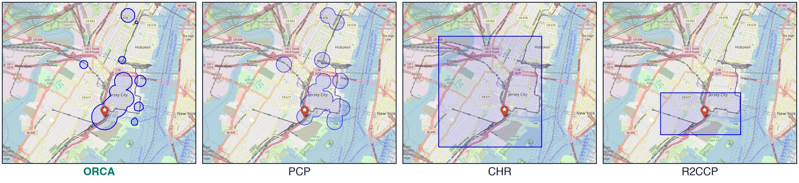

<div align="center">

# Generative Conformal Prediction with Optimized Coverage Allocation

**Minxing Zheng** · **Shixiang Zhu**
<br>
Carnegie Mellon University

[](https://woody-zhu-group.github.io/ORCA-Demo/)
[](https://neurips.cc/virtual/2026/poster/149988)
[](https://arxiv.org/abs/2410.13735)
[](https://minxing-zheng.github.io/files/posters/orca_poster.pdf)
[](https://github.com/Minxing-Zheng/ORCA)
[](LICENSE)

<a href="https://woody-zhu-group.github.io/ORCA-Demo/">
  
</a>

<sub>Standard CP, PCP and ORCA on the same generated samples. <a href="https://woody-zhu-group.github.io/ORCA-Demo/">Open the live demo</a>.</sub>

</div>

## Overview

In this paper, we propose **ORCA** (Optimized Ranking and Coverage Allocation), a method that turns samples from a generative model into prediction sets with guaranteed coverage. Instead of one radius for every sample, ORCA learns a separate radius for each density rank, which gives compact, disconnected sets that follow the shape of the distribution.

1. **Explore.** Draw samples from the generative model and rank them by local density, densest first.
2. **Optimize.** On an exploration split, learn one radius per rank: the smallest balls that still cover the target share of outcomes.
3. **Calibrate.** On a separate calibration split, scale every radius by one common factor, which gives finite-sample marginal coverage.

Across six synthetic and nine real datasets in the paper, ORCA gives the smallest prediction sets on 5 of 6 and 8 of 9, at the same 90% coverage.

## The interactive demo

The demo puts three methods side by side on the same generated samples, for a 2D or a 1D outcome:

- **Standard CP:** one ball around the mean of the samples.
- **PCP:** a ball of the same radius around every sample.
- **ORCA:** a learned radius for each density rank, so samples in low-density regions get small balls or none.

The true distribution has two well-separated modes, shown as contours. The generator is imperfect: 25% of its samples land away from the modes, which is where a single shared radius wastes space.

| Control | What it changes |
| :--- | :--- |
| **2D Demo / 1D Demo** | The dimension of the outcome. |
| **Target coverage** | The coverage level, from 80% to 95%. |
| **Number of generated samples K** | Samples per input, from 20 to 40. |
| **New draw** | A new set of generated samples for the displayed input. |
| **Standard CP / PCP / ORCA** | Which prediction sets are drawn. |

Everything is computed live in the browser. ORCA ranks the samples, runs the greedy coverage-allocation solver on 500 exploration cases and calibrates on 500 more. Coverage is then checked on 1,000 test cases and averaged over 50 random calibration and test splits.

> [!TIP]
> **Full implementation:** the ORCA package (MILP, LP and greedy solvers), a toy notebook and the experiment pipeline are in **[Minxing-Zheng/ORCA](https://github.com/Minxing-Zheng/ORCA)**.

## Real data: NYC bike trips



Prediction sets for the destination of one bike trip (red marker). ORCA and PCP return unions of balls around likely destinations, while CHR and R2CCP return a single rectangle. ORCA shrinks the balls around isolated samples, which gives tighter sets at the same coverage. Map data © OpenStreetMap contributors.

## Run locally

The site is one self-contained `index.html` with no build step.

```bash
git clone https://github.com/Woody-Zhu-Group/ORCA-Demo.git
cd ORCA-Demo
python3 -m http.server 8000
```

Then open <http://localhost:8000>.

## Citation

```bibtex
@inproceedings{zheng2026orca,
  title     = {Generative Conformal Prediction with Optimized Coverage Allocation},
  author    = {Zheng, Minxing and Zhu, Shixiang},
  booktitle = {Advances in Neural Information Processing Systems},
  year      = {2026}
}
```

Released under the [MIT License](LICENSE).
