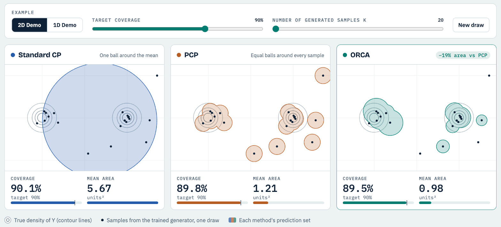

<div align="center">

# Generative Conformal Prediction with Optimized Coverage Allocation

**Minxing Zheng** · **Shixiang Zhu**
<br>
Carnegie Mellon University

[](https://minxing-zheng.github.io/ORCA-Demo/)
[](https://neurips.cc/virtual/2026/poster/149988)
[](https://arxiv.org/abs/2410.13735)
[](https://github.com/Minxing-Zheng/ORCA)

<a href="https://minxing-zheng.github.io/ORCA-Demo/">
  
</a>

<sub>Standard CP, PCP and ORCA on the same generated samples. <a href="https://minxing-zheng.github.io/ORCA-Demo/">Open the live demo</a>.</sub>

</div>

## About

This is the interactive demo for **ORCA** (Optimized Ranking and Coverage Allocation), a method that turns samples from a generative model into prediction sets with guaranteed coverage. Instead of one radius for every sample, ORCA learns a separate radius for each density rank, so the set follows the shape of the distribution.

The demo puts three methods side by side on one draw from a trained generator, in 2D and in 1D:

- **Standard CP**: one ball around the mean.
- **PCP**: equal balls around every sample.
- **ORCA**: a learned radius for each density rank, so stray samples get small balls or none.

Move the target coverage or the number of generated samples, and sampling, ranking, the ORCA-Greedy optimizer, calibration and the coverage check all rerun in the browser.

> [!TIP]
> **Full implementation:** the ORCA package (MILP, LP and greedy solvers), a toy notebook and the experiment pipeline are in **[Minxing-Zheng/ORCA](https://github.com/Minxing-Zheng/ORCA)**.

## Run locally

The site is one self-contained `index.html` with no build step.

```bash
python3 -m http.server 8000
```

Then open <http://localhost:8000>.

## Citation

```bibtex
@inproceedings{zheng2026orca,
  title     = {Generative Conformal Prediction with Optimized Coverage Allocation},
  author    = {Zheng, Minxing and Zhu, Shixiang},
  booktitle = {Advances in Neural Information Processing Systems},
  year      = {2026}
}
```
